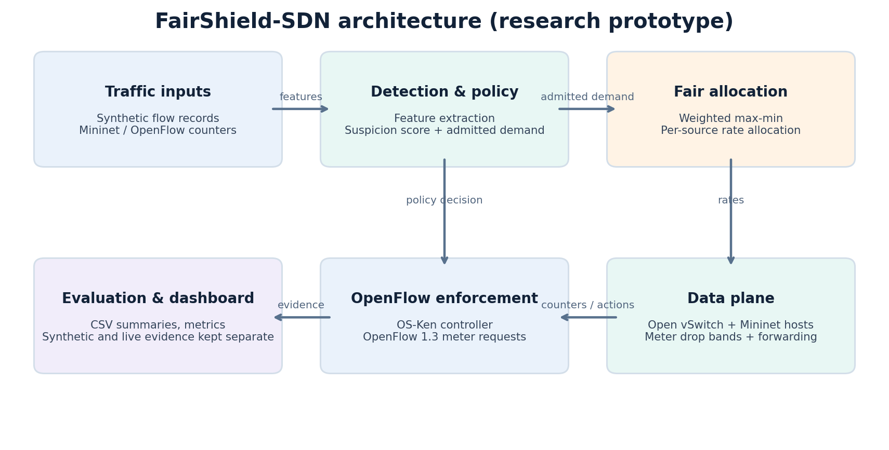
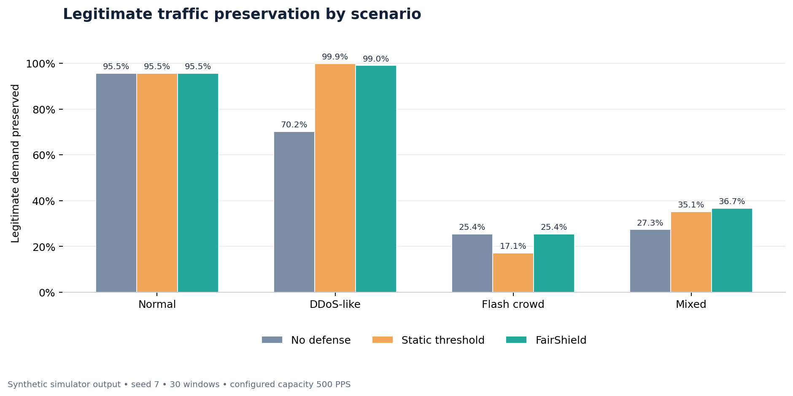
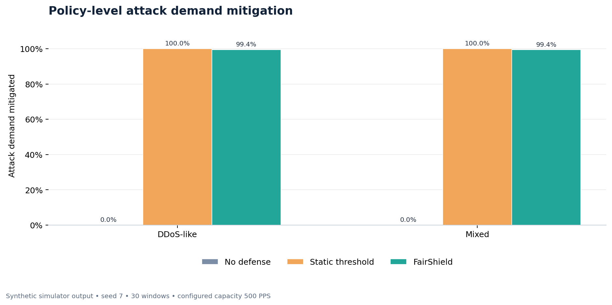
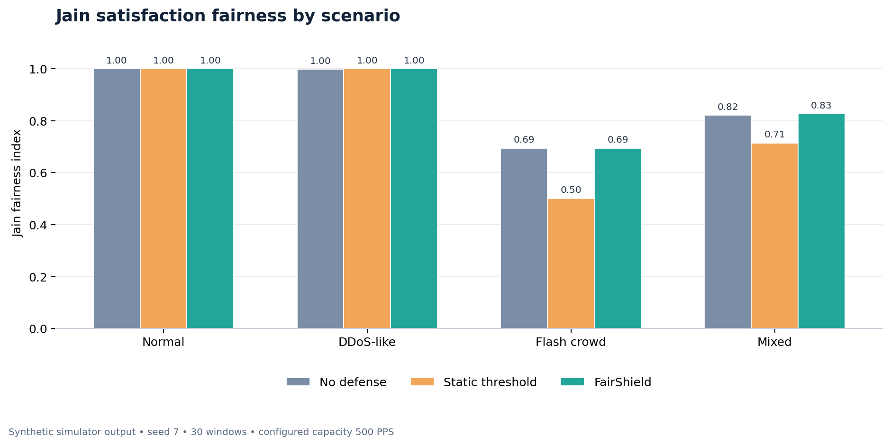
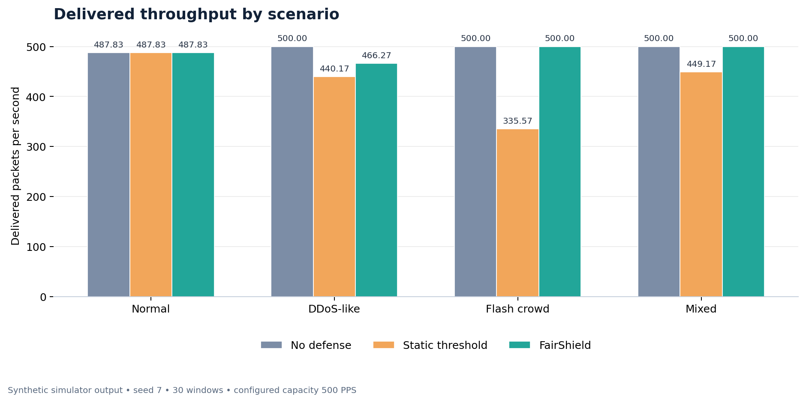

# FairShield-SDN: Adaptive DDoS Detection and Fairness-Aware Traffic Management

**Project report — research prototype V2**
**Live lab validation updated:** 14 November 2026

## Abstract

FairShield-SDN V2 is an educational SDN research prototype combining rule-based traffic anomaly indicators, source-specific admission caps, adaptive feedback, and weighted max-min bandwidth allocation. Its evaluation has two distinct paths: a deterministic Python simulator and a live OS-Ken/OpenFlow 1.3 adapter exercised in a six-host Mininet/Open vSwitch lab.

In the saved 30-window, seed-7 mixed synthetic comparison, V2 adaptive FairShield achieved 38.4% legitimate preservation, 99.8% policy-level attack-demand mitigation, a Jain fairness index of 0.828, and 500 delivered PPS. The corresponding V1 FairShield row achieved 36.7%, 99.4%, 0.827, and 500 delivered PPS. These are synthetic simulator results, not live-network measurements.

The original live demonstration verified meter installation, switch-side drop counters, meter cleanup, and normal UDP recovery after forwarding-state refresh. Later V2 work added offered/forwarded counter collection and legitimate-service feedback. Controller excerpts showed legitimate-service feedback and adaptive cap relaxation under reported headroom conditions. However, live congestion-driven cap tightening has not been conclusively validated. The archived four-source receiver log also does not reconcile with sender totals, so it cannot establish exact end-to-end delivery percentages or successful enforcement at the configured 200 PPS cap. FairShield-SDN remains an academic research prototype, not a production DDoS protection system.

**Keywords:** Software-Defined Networking, OpenFlow 1.3, DDoS mitigation, traffic admission control, weighted max-min fairness, Open vSwitch, Mininet.

## 1. Introduction and problem statement

A shared network bottleneck can become congested when one or more traffic sources offer more packets or bits than the network can carry. DDoS mitigation systems need to suppress harmful traffic while preserving service for legitimate users. A simple high-rate threshold can mistakenly restrict legitimate bursts such as flash crowds. FairShield explores a combined policy: classify suspicious source profiles, cap their admitted demand, and allocate the remaining configured capacity among admitted sources using weighted max-min fairness.

The project is intentionally scoped as a single-switch research prototype. It contains an offline simulator and a separate live SDN adapter. The two paths use different available features and are not presented as the same detector.

## 2. Objectives

1. Build an interpretable flow-level traffic detector.
2. Compare no-defense, static-threshold and FairShield policies in repeatable synthetic scenarios.
3. Allocate constrained capacity with weighted max-min fairness and measure Jain satisfaction fairness.
4. Connect a controller to an OpenFlow 1.3 switch and enforce per-source rate caps with OpenFlow meters.
5. Preserve clear evidence boundaries between simulated performance and live switch behavior.

## 3. System architecture

The main source modules are `models.py`, `detector.py`, `fairness.py`, `controller.py`, `sdn_policy.py`, `ryu_app.py`, `simulator.py`, `reporting.py`, `dashboard.py`, `socket_lab.py`, `ml_optional.py` and `cli.py`.



The offline path generates synthetic flow observations, calculates a suspiciousness score, applies an admission cap and allocates capacity. The dashboard displays experiment outputs. The live path uses OS-Ken and OpenFlow 1.3 to poll switch flow counters and install meters in Open vSwitch.

### 3.1 Offline detector

The simulator detector uses synthetic source-level features including packet rate, SYN ratio, destination-port fan-out and bit rate. Ground-truth scenario labels are used for evaluation, not as detector inputs. Its score is interpretable and rule based.

### 3.2 Live detector

The live adapter derives source-level packet rate, bit rate, mean packet size, and destination-port fan-out from OpenFlow statistics. Standard aggregate flow counters do not reveal TCP SYN flags, so the live adapter uses a distinct high-rate/small-packet heuristic rather than the simulator's full feature set.

The later V2 instrumentation adds low-priority source-observation rules in table 0 and collects counters from all tables. Table 0 source counters are used as offered-packet observations, while table 1 counters are used as forwarded-packet observations. The receiver host `10.0.0.5` is excluded from legitimate-client service calculations. For eligible legitimate sources, the controller estimates service ratio from forwarded and offered packet counters. Missing or incomplete feedback is not treated as healthy feedback; the adaptive policy holds its current cap when feedback is unavailable.

### 3.3 Fairness-aware allocation

Suspicious source demand is capped before capacity allocation. Weighted max-min allocation distributes the configured policy budget among admitted sources without exceeding each source's admitted demand. Jain's fairness index is used as an evaluation metric. The configured live 10,000 kbps capacity budget is a policy parameter, not a measurement of the physical link capacity.

### 3.4 OpenFlow enforcement

The live pipeline uses table 0 for source-specific processing and a default `goto_table:1` path. Low-priority source-observation rules collect offered-packet counters; higher-priority source meter rules take precedence when a source is rate-limited. Table 1 provides learning-switch forwarding and the forwarded-packet counters used by the service-feedback calculation. OpenFlow meters apply a drop band when traffic exceeds the configured rate. The controller can add, modify, or remove meters and associated source rules.

## 4. Implementation environment

The live demo was run in Ubuntu on WSL with Mininet 2.3.0, Open vSwitch 2.17.12, OS-Ken and OpenFlow 1.3. The topology contains six hosts (`h1`–`h6`), one switch (`s1`) and a controller (`c0`). Host `h5` acted as the UDP sink at `10.0.0.5:9000`; `h1` was the controlled high-rate source at `10.0.0.1`.

The controller startup script binds its OpenFlow listener to port 6653. The OVS controller entry `tcp:127.0.0.1:6653` reported `is_connected: true` and state `ACTIVE` during the demonstration.

## 5. Offline synthetic experimental design

The saved reproducibility run used seed 7, 30 windows and a configured bottleneck capacity of 500 packets per second. The same synthetic traffic was evaluated with three policies:

- **No defense:** no attack-specific rate restriction.
- **Static threshold:** fixed packet-rate threshold.
- **FairShield:** suspicious source demand caps followed by weighted max-min allocation.

Scenarios were normal traffic, DDoS-like traffic, flash crowd and mixed traffic. The simulator output is deterministic for the saved seed and is stored under `outputs/reproducibility_seed7_30/`.

## 6. Metrics

- **Legitimate preservation:** legitimate delivered packets per second divided by legitimate offered packets per second.
- **Policy-level attack mitigation:** one minus attack admitted packets per second divided by attack offered packets per second. This is measured before bottleneck contention and is not end-to-end packet loss.
- **Jain fairness:** computed over legitimate sources' delivered/offered satisfaction ratios.
- **Precision, recall and F1:** detector classification metrics against synthetic scenario labels.
- **Delivered PPS:** modeled delivered packet throughput.

## 7. Synthetic experiment results — V1 baseline and V2 extension

### 7.1 DDoS-like scenario

| Policy | Legitimate preserved | Attack mitigated | Jain fairness | F1 | Delivered PPS |
|---|---:|---:|---:|---:|---:|
| No defense | 70.2% | 0.0% | 0.998 | 1.000 | 500.00 |
| Static threshold | 99.9% | 100.0% | 1.000 | 1.000 | 440.17 |
| FairShield V1 fixed-cap | 99.0% | 99.4% | 1.000 | 1.000 | 466.27 |

Static threshold is slightly higher on legitimate preservation and policy-level attack suppression in this generated DDoS-only case. FairShield still suppresses 99.4% of attack demand and delivers more PPS than the static threshold in this run.

### 7.2 Flash-crowd scenario

| Policy | Legitimate preserved | Attack mitigated | Jain fairness | F1 | Delivered PPS |
|---|---:|---:|---:|---:|---:|
| No defense | 25.4% | N/A | 0.694 | 0.000 | 500.00 |
| Static threshold | 17.1% | N/A | 0.500 | 0.000 | 335.57 |
| FairShield V1 fixed-cap | 25.4% | N/A | 0.694 | 0.000 | 500.00 |

The static threshold causes substantial collateral restriction in this flash-crowd simulation. FairShield matches no defense for this generated benign burst, indicating that its multi-indicator rule avoids the static threshold's false-positive restriction. Congestion still limits legitimate preservation.

### 7.3 Mixed scenario

| Policy | Legitimate preserved | Attack mitigated | Jain fairness | F1 | Delivered PPS |
|---|---:|---:|---:|---:|---:|
| No defense | 27.3% | 0.0% | 0.821 | 1.000 | 500.00 |
| Static threshold | 35.1% | 100.0% | 0.714 | 1.000 | 449.17 |
| FairShield V1 fixed-cap | 36.7% | 99.4% | 0.827 | 1.000 | 500.00 |

In this generated mixed case, FairShield has the highest legitimate preservation and fairness among the policies while suppressing 99.4% of attack demand.

### 7.4 Figures

**Figure 1.** Legitimate traffic preservation by scenario.



**Figure 2.** Policy-level attack-demand mitigation.



**Figure 3.** Jain satisfaction fairness.



**Figure 4.** Delivered throughput.



### 7.5 Interpretation and reproducibility caveat

The saved synthetic F1 scores of 1.0 in DDoS-like and mixed cases reflect deliberately separable generated features, not expected real-world model accuracy. A normal scenario contains no attacks, so attack mitigation and detector F1 do not provide useful comparative evidence there. All simulation values must be labelled synthetic.


### 7.6 V2 adaptive policy results

The preceding tables retain the original V1 reference experiment. The following results come from the separate V2 adaptive simulator and must be interpreted as synthetic outcomes.

**Seed 7 — 30 windows, capacity 500 PPS**

| Scenario | Policy | Legitimate preserved | Attack mitigated | Jain fairness | Delivered PPS |
|---|---|---:|---:|---:|---:|
| DDoS | V1 fixed-cap | 98.99% | 99.38% | 1.0000 | 466.27 |
| DDoS | V2 adaptive | 99.50% | 99.80% | 1.0000 | 448.21 |
| Mixed | V1 fixed-cap | 36.73% | 99.36% | 0.8266 | 500.00 |
| Mixed | V2 adaptive | 38.44% | 99.83% | 0.8284 | 500.00 |

**Ten-seed paired results — mean ± sample standard deviation**

| Scenario | Policy | Legitimate preserved | Attack mitigated | Jain fairness | Delivered PPS |
|---|---|---:|---:|---:|---:|
| DDoS | V1 | 98.77 ± 0.42% | 99.375 ± 0.006% | 0.999972 ± 0.000022 | 469.37 ± 5.02 |
| DDoS | V2 | 99.55 ± 0.28% | 99.808 ± 0.014% | 0.999988 ± 0.000011 | 452.05 ± 5.35 |
| Mixed | V1 | 36.91 ± 0.21% | 99.369 ± 0.007% | 0.826969 ± 0.000909 | 500.00 ± 0.00 |
| Mixed | V2 | 38.63 ± 0.22% | 99.830 ± 0.002% | 0.829037 ± 0.000948 | 500.00 ± 0.00 |

V2 improves mean legitimate preservation and policy-level attack-demand mitigation in these generated workloads. In the pure DDoS scenario, mean delivered throughput is lower for V2. This is a trade-off, not evidence of universal performance superiority. Standard deviations describe the generated seeds and are not deployment confidence intervals.

## 8. Live Mininet / Open vSwitch validation

The live experiment is separate from the synthetic comparisons. It used one high-rate UDP source, not multiple attacking hosts.

### 8.1 Topology and connectivity

Mininet listed `c0 h1 h2 h3 h4 h5 h6 s1`. The OpenFlow 1.3 controller target was active. `pingall` reported `0% dropped (30/30 received)`.

### 8.2 Normal traffic baseline

A 100 PPS, 1000-byte UDP sender transmitted 1000 packets to `h5`. The sender reported `average_kbps=800.0`; receiver log samples showed approximately 100 PPS and 800 kbps. This confirmed the sink was reachable and recording normal traffic.

### 8.3 High-rate source and meter enforcement

A controlled `h1` traffic generator was configured for 1000 PPS, 60 seconds and 200-byte payloads. The controller identified source `10.0.0.1` with a score of 0.90; representative observations were 915–1002 PPS and 1.77–1.94 Mbps, with a mean packet size around 242 bytes in flow counters. It logged `RATE_LIMIT`, an admitted rate of 1500 kbps, and meter add/rule requests.

Open vSwitch showed meter 1 with a drop band configured at 1500 kbps and burst size 150. A statistics snapshot after 47.031 seconds showed:

| Meter statistic | Observed value |
|---|---:|
| Packets entering meter | 47,031 |
| Bytes entering meter | 11,381,502 |
| Drop-band packets | 10,515 |
| Drop-band bytes | 2,544,630 |
| Drop-band packet share of meter inputs | 22.36% |

The 22.36% ratio is a calculation from the meter counters for that snapshot. It is not the network's end-to-end loss rate and should not be described as such.

### 8.4 Cleanup and recovery

The controller later logged `METER_DELETE_REQUEST`. Subsequent OVS checks showed an empty meter configuration and no source-specific table-0 meter rule. A normal-flow rule with `idle_timeout=60` had expired during the gap, leaving the controller fallback. The demo operator ran `pingall` to refresh learned forwarding state before repeating the normal test. The sender again reported 1000 packets at 100 PPS / 800 kbps, and the receiver recorded approximately 100 PPS / 800 kbps.

This confirms meter cleanup and successful normal UDP delivery after forwarding-state refresh. It does not prove autonomous immediate restoration without that refresh.

The full transcribed record and commands are in `docs/LIVE_DEMO_EVIDENCE.md`; the repeatable procedure is in `docs/DEMO_RUNBOOK.md`.


### 8.5 V2 follow-up validation — 14 November 2026

A later four-source UDP high-load run was archived in `outputs/final_archive_20261114/`.

| Host | Role | Target rate | Payload | Sender-reported packets |
|---|---|---:|---:|---:|
| h1 | Attack-like | 4,000 PPS | 500 bytes | 120,000 |
| h3 | Attack-like | 4,000 PPS | 500 bytes | 120,000 |
| h2 | Legitimate | 100 PPS | 1,000 bytes | 3,000 |
| h4 | Legitimate | 100 PPS | 1,000 bytes | 3,000 |

The receiver log contains 61–62 interval samples per source. Mean logged rates were 2,362.8 PPS for h1, 2,254.2 PPS for h3, 96.1 PPS for h2, and 95.9 PPS for h4. These are descriptive summaries of the archived receiver log, not steady-state or delivery-rate guarantees. Receiver interval packet sums do not reconcile with sender totals: h2 and h4 each have 6,000 summed receiver interval packets against 3,000 sender-reported packets. The log is therefore not a clean, run-aligned end-to-end delivery record. This experiment does not establish that the attack sources were held to a 200 PPS cap.

The V2 controller instrumentation added table-0 offered-packet observations, table-1 forwarded-packet observations, and a legitimate-service feedback ratio. Controller excerpts from the development session showed h2 and h4 service feedback at 1.000 in observed reporting intervals. Other excerpts showed cap relaxation under reported headroom and meter-drop conditions, including h1 changing from 200 to 240 and then 288 PPS, and h3 changing from 200 to 240 PPS. These excerpts are not archived as a complete, timestamp-aligned controller log for the four-source run.

A valid live demonstration of adaptive cap tightening under genuine congestion, using trustworthy and complete legitimate-service feedback, has not been conclusively established. An earlier startup observation with incomplete or zero legitimate-service data is excluded as evidence of successful congestion control. See `docs/LIVE_DEMO_EVIDENCE.md` for the detailed evidence record.

## 9. Dashboard and supporting demonstrations

The original browser dashboard (`dashboard.py`) provides scenario/window controls, KPI cards, and policy comparison tables for the offline synthetic simulator. The V2 Streamlit research dashboard (`streamlit_app.py`) adds project overview, architecture and control-pipeline explanations, V1/V2 simulator comparisons, archived Mininet sender/receiver evidence, and an interactive adaptive-policy sandbox. The simulation page calls the project's simulator modules; the evidence page reads archived log files. The adaptive-policy sandbox is an illustrative policy demonstration, not a live controller connection. Neither dashboard is a real-time Mininet telemetry display.

The socket lab demonstrates TCP/UDP client-server telemetry. The optional Random Forest module uses synthetic data and is not a validated live detector.

## 10. Automated testing

The project test suite was rerun from the extracted ZIP with:

```bash
PYTHONPATH=src python -m unittest discover -s tests -v
```

**Latest recorded result: 27 tests passed.** Tests cover detector behavior, fairness allocation, simulator metrics, TCP/UDP socket round trips and live policy decisions including recovery from attack-like to normal traffic. These are automated software tests; they are distinct from the live OVS meter demonstration.

## 11. Limitations

1. Synthetic scenarios are not real packet traces or production traffic.
2. A four-source live high-load run was performed, but its archived receiver log does not reconcile with sender totals and no complete, timestamp-aligned controller log is available for that run. It therefore does not establish multi-source DDoS mitigation effectiveness.
3. No controlled live comparison among no-defense, static-threshold and FairShield policies has been completed.
4. The live adapter uses packet rate, mean packet size, bit rate and destination-port fan-out; it does not use TCP SYN-flag features because standard aggregate OpenFlow counters do not expose them.
5. No physical link capacity, latency, jitter, end-to-end packet-loss rate, CPU consumption, table pressure or rule-installation latency was measured.
6. Recovery in the observed demo required `pingall` to refresh a learned forwarding entry after idle expiry. Hysteresis and hold-down behavior are not implemented.
7. The configured 10,000 kbps policy budget is not a measured physical link capacity.
8. Optional ML code is based on synthetic data and has no representative real-world validation.
9. The controller is a single-switch educational prototype, not a production security appliance.

## 12. Conclusion and future work

FairShield-SDN V2 has a reproducible synthetic policy simulator, a stateful adaptive admission policy, a Streamlit research dashboard, and a live OpenFlow adapter exercised in an isolated Mininet lab. In the saved seed-7 mixed synthetic comparison, V2 adaptive FairShield achieved 38.4% legitimate preservation, 99.8% policy-level attack-demand mitigation, 0.828 Jain fairness, and 500 delivered PPS. These are simulator measurements, not live network outcomes.

The original live experiment demonstrated source-meter installation, OVS drop-band counters, meter cleanup, and normal UDP recovery after forwarding-state refresh. Later V2 controller excerpts showed legitimate-service feedback and cap relaxation under reported headroom conditions. The archived four-source run provides traffic-generation and receiver-log evidence, but its receiver totals are not aligned with sender totals and the run does not prove enforcement at a 200 PPS attack cap. Live congestion-driven cap tightening remains unverified.

Further work should capture complete, timestamp-aligned controller, sender, receiver, and switch-counter logs; repeat the multi-source experiment with synchronized start/stop times and independently reconciled packet accounting; verify adaptive tightening under controlled congestion with valid service feedback; compare all policies live under identical workloads; and measure goodput, latency, jitter, CPU use, and rule-installation behavior. Repeated trials, sensitivity analysis, and ablation studies are needed before making broader claims about detection efficacy or production use.
